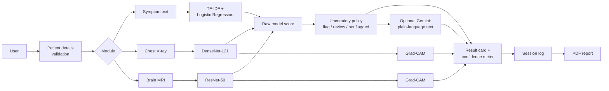
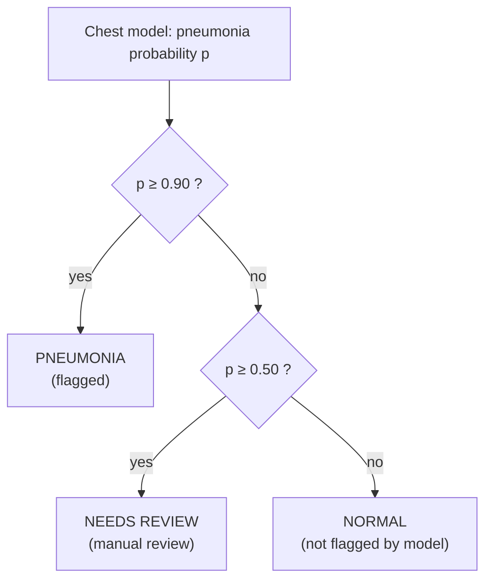

<div align="center">

# ClarityMed AI

**Clinical decision support that shows how sure the model really is.**

Chest X-ray • Brain MRI • Symptom checker • Explainable heatmaps • Calibration-audited confidence • One-click PDF report


</div>

---

## Table of Contents

1. [Overview](#overview)
2. [The Problem](#the-problem)
3. [Our Approach](#our-approach)
4. [System Architecture](#system-architecture)
5. [Modules](#modules)
6. [Uncertainty Policy](#uncertainty-policy)
7. [Results](#results)
8. [Literature and Background](#literature-and-background)
9. [Experiment Log](#experiment-log)
10. [Features](#features)
11. [Repository Structure](#repository-structure)
12. [Quick Start](#quick-start)
13. [Limitations and Ethics](#limitations-and-ethics)
14. [Roadmap](#roadmap)
15. [References](#references)
16. [Acknowledgements](#acknowledgements)
17. [License and Disclaimer](#license-and-disclaimer)
18. [Author](#author)

---

## Overview

ClarityMed AI is a healthcare-AI research prototype that combines three analysis modules in a single interface:

| Module | Input | Output |
|---|---|---|
| Chest X-ray | Chest radiograph | NORMAL / NEEDS REVIEW / PNEUMONIA, plus a Grad-CAM heatmap |
| Brain MRI | Brain MRI slice | glioma / meningioma / pituitary / no tumor, plus a Grad-CAM heatmap |
| Symptom checker | Free-text symptom description | One of 24 conditions, with a confidence score |

Every result is shown with its **raw model score**, a **confidence level**, and a **status** that tells the reader whether to trust the output or send it for manual review. A session report (PDF) collects everything the user explored.

> [!IMPORTANT]
> ClarityMed is a **research prototype**, not a diagnostic system. It has not been clinically validated. Do not use it to make medical decisions and do not enter real patient information.

## The Problem

Most medical-AI demos stop at *"image in, label out"*. That hides three problems:

1. **Confident wrong answers.** A model can report 98% certainty on an image it gets wrong. A single accuracy number does not reveal this.
2. **Opaque decisions.** A label with no view of what influenced it gives a reviewer nothing to question.
3. **Averages hide failure.** Overall accuracy and recall can look strong while one class, one threshold, or one data split quietly fails.

ClarityMed was built around a different question: *how much should we trust a model just because it sounds confident?*

## Our Approach

| Problem | What ClarityMed does about it | Evidence in this repo |
|---|---|---|
| Overconfidence | Measures calibration (ECE, reliability diagrams, temperature scaling) instead of trusting raw softmax | [Results](#results), [`experiments/exp03_calibration_audit.py`](experiments/exp03_calibration_audit.py) |
| Opaque predictions | Grad-CAM heatmaps on both image modules, described as an inspection aid and not proof of medical reasoning | App UI |
| Hidden failure | Failure-case analysis, per-class metrics and an explicit review band instead of forcing a label | [Uncertainty Policy](#uncertainty-policy) |
| Over-claiming | Limitations are documented, including known weaknesses of the evaluation itself | [Limitations and Ethics](#limitations-and-ethics) |
| Fragmented tooling | One interface and one PDF report across all modules | [Features](#features) |

## System Architecture



**Privacy note on the language model.** Only the module name, the result label and the model score are sent to Gemini. The image, the symptom text and the patient details are not. The call is optional: without an API key a fixed fallback sentence is shown.

## Modules

### Chest X-ray: DenseNet-121 with Grad-CAM

| Item | Detail |
|---|---|
| Task | Binary: NORMAL vs PNEUMONIA |
| Data | Chest X-ray pneumonia dataset (Kermany et al. [3]), hosted on Kaggle |
| Backbone | DenseNet-121 [2], ImageNet pre-trained |
| Transfer learning | First 70% of parameters frozen, remaining 30% fine-tuned |
| Head | Dropout(0.4) → Linear(256) → ReLU → Linear(2) |
| Loss | Class-weighted cross-entropy (inverse class frequency) to handle class imbalance |
| Optimiser | AdamW, learning rate 1e-4, weight decay 1e-4, cosine annealing schedule |
| Augmentation | Random horizontal flip, rotation up to 10°, resize to 224×224, ImageNet normalisation |
| Model selection | Best validation accuracy checkpoint |
| Explainability | Grad-CAM on the last convolution of dense block 4 [5] |

### Brain MRI: ResNet-50 with Grad-CAM

| Item | Detail |
|---|---|
| Task | 4 classes: glioma, meningioma, pituitary, no tumor |
| Data | [Brain Tumor MRI Dataset](https://www.kaggle.com/datasets/masoudnickparvar/brain-tumor-mri-dataset) (Masoud Nickparvar) |
| Backbone | ResNet-50 [1], ImageNet pre-trained |
| Transfer learning | First 70% of parameters frozen, remaining 30% fine-tuned |
| Head | Dropout(0.4) → Linear(256) → ReLU → Linear(4) |
| Optimiser, augmentation, selection | Same recipe as the chest module |
| Explainability | Grad-CAM on the last bottleneck convolution of `layer4` |

### Symptom checker: TF-IDF with Logistic Regression

| Item | Detail |
|---|---|
| Task | Multi-class text classification over 24 conditions |
| Data | Symptom2Disease: 1,200 text descriptions |
| Model | TF-IDF features + Logistic Regression |
| Output | Predicted condition with `predict_proba` confidence |
| Caveat | Small, text-only dataset. No clinical validation. English input only. |

## Uncertainty Policy

The interface never forces a confident-looking label when the model is unsure.



| Module | Rule | Status shown |
|---|---|---|
| Chest X-ray | p ≥ 0.90 | Flagged |
| Chest X-ray | 0.50 ≤ p < 0.90 | Uncertain: manual review |
| Chest X-ray | p < 0.50 | Not flagged by model |
| Brain MRI | confidence < 60% | Low confidence: manual review |
| Symptom checker | confidence < 60% | Low confidence: see a doctor |

Confidence levels on the meter: **High** ≥ 80%, **Moderate** 60–80%, **Low** < 60%. Every meter carries the note *"This is the model's raw score, not a calibrated probability."*

> **"Not flagged by model" does not mean healthy.** It means the model did not flag a finding. Models miss things.

## Results

All numbers below were measured on the held-out test sets in the research notebook. They are reported as measured; no metric was adjusted.

### Discrimination and calibration

| | Brain MRI (ResNet-50) | Chest X-ray (DenseNet-121) |
|---|---|---|
| Test accuracy | 0.945 | 0.840 (argmax at 0.5 cut-off) |
| ECE, validation | 0.009 | 0.007 |
| ECE, test (raw) | 0.039 | 0.114 |
| ECE, test (temperature-scaled) | 0.031 (T = 1.27) | 0.107 (T = 1.19) |
| Brier score (raw → scaled) | 0.0948 → 0.0925 | 0.2671 → 0.2598 |
| Log-loss (raw → scaled) | 0.331 → 0.274 | 0.631 → 0.548 |
| Mean confidence, correct predictions | 0.991 | 0.969 |
| Mean confidence, **wrong** predictions | 0.853 | 0.875 |
| Wrong predictions among those at 90%+ confidence | 49 of 1,525 (3.2%) | 59 of 533 (11.1%) |

Temperature scaling was fitted on a clean (non-augmented) validation split only, never on the test set. It is measured here but **not applied** in the app.

### Findings

> [!IMPORTANT]
> **Calibration is a property of the model and the data it is measured on.** The chest model looked almost perfectly calibrated on validation data (ECE 0.007) and clearly miscalibrated on the test set (ECE 0.114). Temperature scaling, fitted on validation data, barely helped.

- **Confident mistakes exist.** On both modules, wrong predictions still carried high mean confidence (0.853 and 0.875).
- **Cause not established.** The validation-to-test gap on the chest model could be dataset shift, or a validation split too similar to the training data (the same patient can appear in several images). Both would produce the same numbers. A patient-level split is the planned next test.
- **Per-class weakness (brain).** Glioma is the weakest class; in Experiment 01, 46 of 400 glioma test images were predicted as meningioma.
- **Threshold tuning (chest).** In Experiment 02 raising the decision threshold to 0.90 improved NORMAL recall from about 0.60 to 0.76 while keeping pneumonia sensitivity high (reported earlier as roughly 90% accuracy and 98% pneumonia recall at that operating point). **That threshold was chosen on the test set, so these figures are optimistic.**

## Literature and Background

ClarityMed sits at the intersection of four lines of work. It does not claim to advance any of them; it applies them with their known caveats attached.

**1. Deep transfer learning for medical imaging.** Residual networks [1] and densely connected networks [2] pre-trained on ImageNet are standard starting points for small medical datasets. The pediatric chest X-ray dataset used here was introduced by Kermany et al. [3]. CheXNet [4] showed that a DenseNet-121 can be trained for pneumonia detection on chest X-rays and reported performance comparable to radiologists on its own test protocol. ClarityMed uses the same backbone family with a smaller, frozen-then-fine-tuned recipe and makes no state-of-the-art claim.

**2. Explainability.** Grad-CAM [5] localises the regions that influenced a CNN prediction using gradients of the target class. Adebayo et al. [6] showed that some saliency methods can look convincing while being insensitive to the model's learned weights, and Rudin [7] argues that explanations of black-box models can be unreliable in high-stakes settings. For this reason ClarityMed presents heatmaps strictly as an *inspection aid*. In the brain MRI experiment a confidently wrong prediction produced a plausible-looking heatmap, which is the failure mode these papers warn about.

**3. Calibration and uncertainty under dataset shift.** Guo et al. [8] showed that modern deep networks are often overconfident and that temperature scaling is a simple, effective post-hoc correction on in-distribution data. Ovadia et al. [9] showed that calibration degrades as data shifts away from the training distribution. The chest X-ray result in this project, good calibration on validation and poor calibration on test with little gain from temperature scaling, is consistent with that picture, although the cause here is not yet isolated.

**4. Transparent reporting.** Model cards [10] argue that every model should ship with its intended use, evaluation conditions and limitations. The [Limitations and Ethics](#limitations-and-ethics) section follows that spirit.

## Experiment Log

ClarityMed was developed as a public series of small, evidence-driven experiments.

| # | Experiment | Question | Status |
|---|---|---|---|
| 01 | Brain MRI classification + Grad-CAM | Does a confident prediction mean a correct one? | Done |
| 02 | Chest X-ray + Grad-CAM + threshold and failure analysis | Can a threshold change fix a confident wrong answer? | Done |
| 03 | Calibration audit | Do confidence scores match how often the model is right? | Done (see [Results](#results)) |
| 04 | Data audit + symptom checker | Are the headline numbers inflated by duplicate or leaked data? | Planned |
| 05 | Full integration: interface + PDF report | Can uncertainty be communicated to the end user? | Current app |

## Features

- **Patient information form** with input validation.
- **Three analysis modules** in one tabbed interface.
- **Confidence meter** with zones, a decision-threshold marker and a plain-language confidence level.
- **Grad-CAM overlay** for image modules.
- **Plain-language explanation** (optional, via Gemini) that avoids diagnosing.
- **Session report (PDF):** patient details, a summary table of every analysis explored, per-module detail with heatmaps, next-step guidance and a disclaimer.
- **Accessible UI:** keyboard focus outlines, responsive layout, reduced-motion support.

## Repository Structure

```
claritymed/
├── app.py                          # Gradio app: inference, Grad-CAM, uncertainty policy, PDF report
├── requirements.txt                # Pinned dependencies
├── README.md
├── LICENSE
├── experiments/
│   └── exp03_calibration_audit.py  # Reliability diagrams, ECE, temperature scaling
└── model/                          # NOT stored in this repository (see Quick Start)
    ├── chest_xray_densenet121_v2_best.pth
    ├── brain_mri_resnet50_best.pth
    ├── chest_xray_config.json
    ├── symptom2disease_model.joblib
    └── symptom2disease_vectorizer.joblib
```

## Quick Start

Tested with Python 3.13 (Google Colab environment).

```bash
git clone https://github.com/ailanasirai/claritymed.git
cd claritymed
pip install -r requirements.txt
```

1. Place the five model files listed above in a `model/` folder next to `app.py`. They are not stored in this repository.
2. *(Optional)* Set `GEMINI_API_KEY` as an environment variable to enable the plain-language explanation.
3. Run:

```bash
python app.py
```

Training was done in Google Colab. The training notebook is not included in this repository yet.

## Limitations and Ethics

Please read these before using or citing this project.

| Area | Limitation |
|---|---|
| Clinical status | No clinical validation, no prospective study, no external test set. Not a medical device. |
| Evaluation | The chest decision threshold (0.90) was selected on the test set, so chest results are optimistic. |
| Calibration | The validation-to-test calibration gap on the chest model is unexplained. Temperature scaling is measured but not applied. |
| Data splits | Validation was split from training data at the image level. Patient-level leakage cannot be ruled out for the chest dataset. |
| Out-of-distribution input | There is no out-of-distribution detector. The image models return an answer for any image, including non-medical ones. |
| Explainability | Grad-CAM is an inspection aid. It does not prove the model reasons like a clinician. |
| Symptom checker | Trained on 1,200 short English descriptions of 24 conditions. It does not replace a clinical assessment. |
| Scope | Only the classes listed above are covered. Anything else is out of scope. |
| Privacy | Do not enter real patient data. The app writes only a temporary report file per session. |

## Roadmap

- [ ] Patient-level train/validation split for the chest dataset to test the leakage hypothesis
- [ ] Choose the chest threshold and the review band on validation data, not the test set
- [ ] Apply and evaluate temperature scaling inside the app
- [ ] Out-of-distribution rejection for non-radiograph input
- [ ] Data audit for duplicate and near-duplicate samples (Experiment 04)
- [ ] Cross-validation and external validation on a second dataset
- [ ] Urdu symptom input
- [ ] Publish the training notebook

## References

1. K. He, X. Zhang, S. Ren, J. Sun. *Deep Residual Learning for Image Recognition.* CVPR, 2016.
2. G. Huang, Z. Liu, L. van der Maaten, K. Q. Weinberger. *Densely Connected Convolutional Networks.* CVPR, 2017.
3. D. S. Kermany et al. *Identifying Medical Diagnoses and Treatable Diseases by Image-Based Deep Learning.* Cell, 172(5), 2018.
4. P. Rajpurkar et al. *CheXNet: Radiologist-Level Pneumonia Detection on Chest X-Rays with Deep Learning.* arXiv:1711.05225, 2017.
5. R. R. Selvaraju et al. *Grad-CAM: Visual Explanations from Deep Networks via Gradient-Based Localization.* ICCV, 2017.
6. J. Adebayo et al. *Sanity Checks for Saliency Maps.* NeurIPS, 2018.
7. C. Rudin. *Stop Explaining Black Box Machine Learning Models for High Stakes Decisions and Use Interpretable Models Instead.* Nature Machine Intelligence, 1, 2019.
8. C. Guo, G. Pleiss, Y. Sun, K. Q. Weinberger. *On Calibration of Modern Neural Networks.* ICML, 2017.
9. Y. Ovadia et al. *Can You Trust Your Model's Uncertainty? Evaluating Predictive Uncertainty Under Dataset Shift.* NeurIPS, 2019.
10. M. Mitchell et al. *Model Cards for Model Reporting.* FAT*, 2019.

## Acknowledgements

- Chest X-ray data: Kermany et al., distributed on Kaggle.
- Brain MRI data: Masoud Nickparvar, Brain Tumor MRI Dataset, Kaggle.
- Symptom data: Symptom2Disease, Kaggle.
- Built with PyTorch, torchvision, scikit-learn, Gradio and fpdf2.

Each dataset keeps its own license and terms. Check them before redistributing data or trained weights.

## License and Disclaimer

Code is released under the [MIT License](LICENSE). Datasets and trained weights are subject to their own terms.

**Disclaimer.** ClarityMed AI is a research and educational prototype. It is not a medical device and must not be used for diagnosis, treatment or any clinical decision. Model scores are raw outputs, not calibrated probabilities.

## Author

**Aila Nasir** · Healthcare AI · [GitHub](https://github.com/ailanasirai) · [LinkedIn](https://www.linkedin.com/in/aila-nasir)
